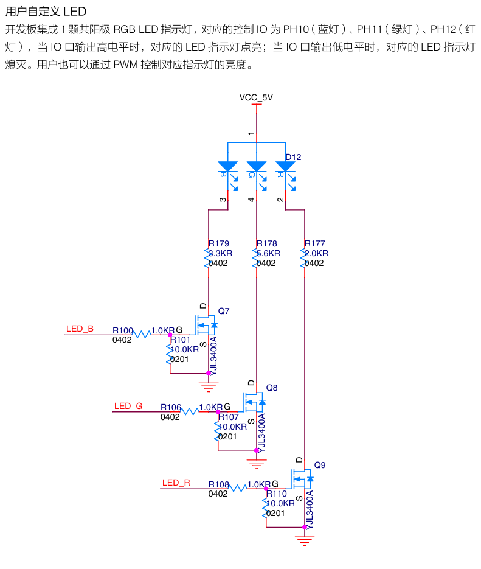

# bsp_led


<p align='right'>yichengz@wustl.edu</p>

>TODO:
>

## Overview and Encapsulation

This bsp contains PWM set comparison register(CCR) function to set PWM output for each RGB channel on C Board LED. The LED uses three TIM5 channels for PWM output, PSC = 1-1 for original clock frequency, ARR = 65536-1 (256*256-1) since each R/G/B value multiplies alpha is 0-255 times 0-255 = 65025 < 65536.

## Code Structure

One function that sets each PWM channel's CCR according to parameter aRGB value

## Data Types

```c
static uint8_t alpha;
static uint16_t red,green,blue;
```
* alpha is 8 bits since it takes two bytes in aRGB parameter
* red/green/blue is 16 bits since they are the product of R/G/B value in aRGB parameter(8bits) and alpha(8bits)

## Interfaces

```c
extern void aRGB_led_show(uint32_t aRGB);
```
* sets PWM comparison value according to different bits in aRGB

## User Manual Screenshot

